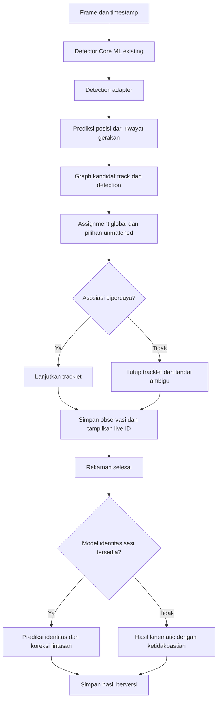

# Flow dan prompt agent — tracking benur mengikuti TRex

## Keputusan arsitektur

Target: detector Core ML yang sudah berjalan tetap dipakai sebagai pemasok deteksi. Tambahkan backend tracking yang mengikuti kinematic matching dan pengelolaan tracklet TRex. BoT-SORT tetap tersedia sebagai baseline pembanding/rollback, bukan dijalankan berurutan dengan TRex pada frame yang sama.

Baseline acuan algoritma: paper TRex 2021. Source TRex sekarang telah berkembang dan README menyebut dukungan detector YOLO sejak versi 2.0. Agent harus memilih serta mencatat commit/tag yang digunakan; jangan mencampurkan rumus, default dan fallback antarversi tanpa penjelasan.

Visual identification berbasis pembelajaran individu adalah tahap berbeda dari kinematic tracking. Live ID tetap bersifat sementara; koreksi identitas dapat menghasilkan revisi hasil sesudah rekaman.

## Flow

Detection yang belum mendapat pasangan diproses oleh lifecycle kandidat baru. Track tanpa pengukuran menjadi missing/lost sesuai implementasi acuan. Diagram menyederhanakan cabang lifecycle ini.

## Prompt siap diberikan ke coding agent

### Tujuan tugas

Audit repository iOS ini, lalu implementasikan backend object tracking yang mengikuti mekanisme tracking TRex. Gunakan model deteksi biasa yang sudah tertanam dan sudah berjalan. BoT-SORT existing dipertahankan sebagai backend pembanding/rollback.

Fokus tugas adalah algoritma tracking: prediksi gerakan, graph pencocokan, assignment global, lifecycle track, tracklet terpercaya, serta jalur koreksi identitas berdasarkan penampilan. Jangan hanya membungkus output BoT-SORT dengan ID tambahan lalu menyebutnya TRex.

Kerjakan kode, integrasi, penyimpanan dan verifikasi, bukan berhenti pada rencana. Gunakan struktur dan deployment target yang benar-benar ada di repository.

### Konteks awal aplikasi

- Deteksi foto sudah berjalan.
- Tracking kamera/video sudah berjalan menggunakan BoT-SORT tanpa ReID.
- ID internal tracker dapat meloncat.
- Display ID dipetakan berurutan setelah konfirmasi, default 3 frame berturut-turut.
- Lost buffer sekitar 1 detik.
- Mapping saat ini di RAM; sesi/reset pengaturan dapat mengulang nomor dari 1.
- Total ID tercatat adalah jumlah lintasan terkonfirmasi, bukan ground truth jumlah benur.
- Foto menghitung detection tanpa tracking.
- Lokasi yang pernah disebut: Services/OnDeviceInference.swift dan TrackPresentation. Temukan lokasi aktual; jangan mengandalkan nomor baris lama.

### 1. Audit source aplikasi dan source TRex

Baca AGENTS.md yang berlaku. Temukan pipeline kamera, impor video, foto, detector decoding/NMS, koordinat, tracker, threading dan penyimpanan sesi. Catat build scheme dan perintah test yang tersedia.

Baca sumber primer:

- Paper: https://elifesciences.org/articles/64000
- PDF: https://elifesciences.org/articles/64000.pdf
- Source: https://github.com/mooch443/trex
- Parameters: https://trex.run/docs/parameters_trex.html
- Visual identification: https://trex.run/docs/identification.html

Untuk paper, periksa bagian Tracking dan Appendix D tentang matching antarframe beserta bagian terkait prediksi posisi dan visual identification. Telusuri fungsi yang sesuai pada commit/tag acuan. Catat path file, simbol dan rumus yang benar-benar ditemukan. Jangan mengarang nama fungsi, formula probabilitas atau konstanta.

Periksa implementasi paper 2021 dan source yang dipilih secara terpisah. Paper menjelaskan tree-based assignment dengan fallback Hungarian; dokumentasi yang lebih baru mencantumkan beberapa matching mode. Pilih perilaku acuan secara eksplisit, lalu tulis mapping source ke implementasi iOS.

Buat dokumen pendek TRexTrackingDesign.md: mekanisme yang direproduksi, adaptasi akibat hanya tersedia bounding box, fitur yang belum memiliki data/model, serta versi acuan. Pertahankan pemberitahuan/lisensi yang relevan bila menggunakan source pihak lain.

### 2. Pisahkan detector dan tracker melalui backend interface

Buat interface mengikuti gaya repository, misalnya TrackingBackend dengan update(detections, timestamp, frameContext), reset dan finalize.

Backend yang diimplementasikan:
- ExistingBoTSORTBackend: adapter algoritma yang sudah berjalan.
- TRexKinematicBackend: backend baru sesuai algoritma acuan.

Pilih backend pada awal sesi melalui setting developer/eksperimen yang sesuai. Switching di tengah sesi memfinalisasi epoch lama dan membuat epoch baru. Tidak ada pipeline BoT-SORT lalu TRex yang saling menimpa ID.

Detector, NMS dan mode foto tetap digunakan. Jangan menambahkan paket Ultralytics Python atau training Python ke runtime iOS.

Detection adapter harus menyediakan:
- Detection index scoped frame.
- Bbox/center dalam koordinat video sumber yang konsisten.
- Timestamp media, sourceFrameIndex, model/config version.
- Detection confidence dan class.
- Crop/frame reference opsional.
- Mask/contour/posture hanya jika benar-benar tersedia.

Pusat bbox bukan centroid mask tubuh. Luas bbox bukan luas blob. Dokumentasikan substitusi ini sehingga mode bbox dinyatakan adaptasi TRex. Jangan membuat contour sintetis dan menganggapnya segmentasi tubuh.

### 3. Implementasikan prediksi kinematik TRex

Port atau reimplementasikan prediksi berdasarkan riwayat posisi, kecepatan dan perubahan arah/kecepatan sudut sesuai source yang diverifikasi.

- Gunakan delta waktu aktual dari media.
- Bedakan motion heading dari body/head orientation.
- Untuk gerakan sangat kecil, arah gerak dapat tidak terdefinisi; jangan menambahkan arah palsu.
- Terapkan perilaku prediksi saat missing/lost dan pengurangan expected speed hanya jika cocok dengan versi acuan; nyatakan parameter adaptasi.
- Gunakan gerakan dalam koordinat yang konsisten; kamera bergerak perlu dikompensasi secara tervalidasi atau ditandai.
- Jangan mewajibkan IoU positif: benur kecil dapat berpindah tanpa overlap bbox antarframe.
- Benur diam tetap valid. Tidak ada minimum swimming speed untuk menjadi track.
- Tidak ada klaim bahwa ini tetap Kalman BoT-SORT bila mekanismenya sudah diganti.

Jika mengubah rumus untuk bbox/performa, pisahkan dalam strategi yang bernama jelas dan tulis perbedaannya. Jangan mempertahankan Kalman+IoU existing lalu melabelinya sebagai reproduksi penuh prediksi TRex.

### 4. Bentuk probabilitas/score dan candidate graph

Untuk setiap track yang eligible dan detection sekarang:
1. Hitung kemungkinan hubungan menggunakan fungsi acuan TRex.
2. Terapkan gating yang relevan seperti waktu hilang dan batas perpindahan.
3. Tambahkan edge yang eligible ke graph track–detection.

Parameter/source yang perlu diperiksa meliputi match_min_probability, track_max_speed, track_time_probability_enabled, track_max_reassign_time dan parameter prediksi terkait, jika memang tersedia pada commit yang dipilih.

Pisahkan:
- Detector confidence.
- Kinematic association probability/score.
- Appearance identity prediction.
- Ambiguity/quality.

Threshold probabilitas TRex hanya berlaku pada rumus dan normalisasi aslinya. Jika menggunakan heuristic substitute, sebut score dan kalibrasikan; jangan langsung menyalin nilai default numerik TRex ke skor lain.

Informasi ukuran tubuh yang tidak tersedia dari detector tidak boleh diisi dengan luas bbox dan diklaim identik blob. Fitur bbox tambahan boleh digunakan pada mode adaptasi yang tercatat.

### 5. Assignment global sesuai TRex

Implementasikan matching yang menjaga satu detection maksimal untuk satu track dan satu track maksimal menerima satu detection pada frame yang sama.

- Sertakan pilihan unmatched. Jangan memaksa track berpasangan.
- Reproduksi objective tree-based acuan yang telah diverifikasi.
- Gunakan pruning dan candidate gating yang sesuai.
- Terapkan fallback Hungarian sesuai perilaku sumber acuan; pastikan dummy/unmatched dan forbidden edges benar.
- Terapkan batas kerja yang dapat direproduksi, misalnya node expansion budget. Ukur latency dan log fallback.
- Pada exact mode, fallback harus menyelesaikan objective yang setara, bukan diam-diam berubah menjadi greedy nearest-neighbor.
- Approximate mode hanya sebagai opsi eksplisit dengan nama, perbedaan dan metrik tersendiri.
- Seluruh mode harus deterministik untuk input/config sama, termasuk aturan tie-break.

Validasi hasil tree solver terhadap Hungarian dan exhaustive enumeration pada graph kecil. Periksa bahwa objective, unmatched cost, gate dan penanganan forbidden edges konsisten. Jangan menambahkan spatial partitioning yang memutus edge valid dan mengubah solusi tanpa pelabelan.

### 6. Lifecycle track dan trusted tracklet

Pisahkan live track identity dari batas tracklet:
- Track live dapat dilanjutkan dengan ID sementara.
- Saat keyakinan kontinuitas rendah, tracklet berakhir dan tracklet baru dapat dimulai meski live track ID masih sama.
- Sumber TRex menjelaskan pemutusan melalui track_trusted_probability dan kondisi risiko lain. Verifikasi perilaku yang dipilih.
- Bedakan match minimum untuk eligibility dengan trust threshold untuk kontinuitas tracklet.
- Deteksi baru tetap melalui konfirmasi kandidat yang existing, default 3 frame, sebagai adaptasi aplikasi yang terdokumentasi.
- Track yang missing boleh diprediksi tetapi prediksi bukan detection aktual.
- Aturan pemutusan pada gap, kecepatan sangat tinggi atau timestamp abnormal harus terdokumentasi dan configurable.
- Missing singkat tidak selalu harus memutus tracklet jika perilaku acuan mempertahankannya; ikuti aturan source dan tandai interval tanpa observasi.
- Crossing tidak otomatis berarti salah ID. Catat competing matches dan ambiguity dari bukti yang tersedia.
- Box overlap bukan bukti dua tubuh benar-benar bertumpuk.
- Jangan otomatis memulai individu biologis baru setiap kali membuat tracklet.

ID minimum: sessionID, trackingEpochID, backendTrackID, trackletID, displayID, identityHypothesisID opsional, analysisVersion. UUID/scoped key mencegah collision saat nomor tracker direset.

### 7. Persistensi, realtime dan quality telemetry

Simpan:
- Observasi: timestamp, bbox/center, detection confidence, assigned track, tracklet, observed/predicted, diagnostics.
- Track/tracklet: durasi, state, alasan batas dan ringkasan quality.
- Event: candidate, confirmed, missing, reacquired, removed, low-trust, crossing, reset, fallback.
- Versi config, source algoritma dan backend.
- Raw tracks dan corrected identity mapping secara terpisah.
- Referensi video/crop yang diperlukan untuk appearance.

Gunakan actor/serial queue untuk state tracking dan snapshot untuk UI. Pakai bounded queue, batch persistence serta pembatasan crop sampling; jangan menyimpan seluruh video dalam RAM. Gunakan timestamp aktual bila inference frame terlewat. Rekam FPS inferensi, latency, fallback count, dropped frames, jumlah candidate edges, memori dan kondisi perangkat. Preview FPS bukan inference FPS.

Jangan mengklaim 256 benur/60 FPS di iPhone tanpa benchmark. Ukur baseline BoT-SORT dan TRex backend pada video, resolusi serta perangkat yang sama.

### 8. Occlusion/blob splitting

TRex memiliki metode berbasis piksel untuk memisahkan blob. Dengan detector bbox biasa:
- Simpan suspected merged detection/occlusion sebagai kondisi ambigu.
- Jangan memotong satu bbox menjadi dua bbox buatan.
- Jangan memberikan satu detection sebagai observasi aktual bagi dua individu.
- Jika segmentasi/background subtraction yang andal tersedia, implementasikan adaptive threshold atau seeded watershed hanya berdasarkan source acuan dan validasi.
- Cegah satu benur terpecah menjadi kepala/ekor yang dihitung dua.
- Jika hanya bbox, nyatakan blob splitting belum tersedia dan lanjutkan mekanisme missing/reacquisition.

Posture, kepala–ekor dan visual field tidak termasuk baseline bbox. Untuk mereplikasi fitur tersebut diperlukan data tubuh yang sesuai.

### 9. Visual identification dan koreksi setelah rekaman

Bagian ini wajib dipisahkan dari live kinematic tracking. Kinematic matching tidak menjamin identitas setelah oklusi ambigu.

Untuk alur penuh ala TRex:
1. Tentukan N individu pada kelompok tertutup, dengan provenance jumlah tersebut.
2. Cari global segment ketika semua N terlihat terpisah dan memiliki tracklet yang dipercaya.
3. Kumpulkan crop setiap individu dari segmen tersebut sebagai pseudo-label awal.
4. Normalisasi gambar sesuai informasi yang tersedia. Pose normalization membutuhkan posture nyata; bbox tidak memberikan arah kepala.
5. Latih classifier identitas sesi/kelompok, evaluasi dan tambahkan segmen lain secara konservatif sesuai prosedur acuan.
6. Prediksi identitas pada tracklet/observasi yang relevan.
7. Proses ulang assignment/koreksi identitas sesuai metode TRex yang diverifikasi.
8. Simpan corrected mapping sebagai versi baru dan pertahankan raw result.

Jika N tidak diketahui atau global segment tidak tersedia, laporkan syarat belum terpenuhi; jangan membuat global segment palsu dari total tracker ID.

Model detector spesies benur bukan classifier identitas individu. Model appearance dari video lain belum tentu mengenali hewan sesi ini.

Implementasi yang dapat diselesaikan tanpa model baru:
- Crop/metadata export dengan quality dan provenance.
- Global-segment candidate detection dengan prasyarat eksplisit.
- Kontrak AppearanceIdentityProvider dengan status unavailable.
- Import/inference model nyata bila tersedia dan kompatibel.
- Penyimpanan hasil revisi dan penanganan unavailable yang benar.

Training per sesi dapat dilakukan di komputer terpisah. Jangan membuat stub yang selalu mengembalikan skor tinggi lalu mengklaim ReID selesai. Jika menambahkan motion-only tracklet stitching sebagai fallback, beri nama berbeda: itu bukan visual identity correction TRex.

Jangan membagi adjacent crops secara acak lalu mengklaim generalisasi identitas. Uji pada segmen waktu berbeda dan crossing dengan ground truth manual. Uniqueness tinggi membantu konsistensi, tetapi tidak membuktikan label biologis benar.

### 10. UI, counting dan gerakan

- Pertahankan mode foto tanpa tracking.
- Tampilkan backend aktif pada diagnostik.
- Live ID adalah identitas tracking sementara; final identity dapat direvisi setelah pemrosesan.
- Jangan renumber display ID berulang selama live hanya agar berurutan.
- Pisahkan current detections, confirmed tracks with current measurements, missing tracks, total confirmed tracks, total tracklets dan corrected identity hypotheses.
- Total tracklet/track ID tidak otomatis menjadi jumlah benur.
- Jika N diinput, tampilkan sebagai jumlah input; jangan menyebutnya hasil hitung.
- identityHypothesisID hanya dugaan berbasis metode/versi hasil.
- Hitung kecepatan/jarak pada observasi valid; jangan menjembatani gap sebagai lintasan yang benar-benar diamati.
- Tanpa kalibrasi fisik gunakan px/s, bukan mm/s karangan.
- Missing/predicted-only bukan bukti benur diam atau mati.
- Jangan menambahkan klaim kesehatan/SR dari tracker ini.

### 11. Verifikasi wajib

A. Detector foto tetap bekerja.
B. Satu objek stabil menghasilkan lintasan kontinu.
C. Diam tetap terlacak.
D. Gap pendek/panjang mengikuti lifecycle dan reassignment acuan.
E. Crossing simetris menghasilkan status risiko; tidak ada jaminan ID benar tanpa bukti.
F. Satu detection tidak dipakai dua track.
G. Dua tracklet dengan observasi bersamaan tidak mendapat identity individu yang sama pada model satu kamera, termasuk setelah merge transitif.
H. Solver tree, Hungarian dan enumeration graph kecil mempunyai objective konsisten.
I. Unmatched/forbidden edges/tie-break/fallback benar.
J. Timestamp tidak seragam menghasilkan gerakan dan gating benar.
K. Konfirmasi, reset, backend switch dan epoch mencegah collision.
L. Konversi detector coordinates/overlay/crop benar untuk orientation, mirroring dan letterboxing.
M. Appearance unavailable tidak merusak tracking dan tidak diklaim aktif.
N. Cancel/re-run analisis tidak menimpa raw data atau membuat mapping ganda.
O. Persistence dan memory tetap terbatas pada sesi panjang.

Jika video beranotasi tersedia, ukur ID switches, fragmentation, IDF1/HOTA bila tooling mendukung, association/link precision, coverage dan counting error terhadap manual count. Tanpa anotasi, laporkan keterbatasan; synthetic tests bukan bukti akurasi pada benur.

### 12. Urutan pengerjaan dan definition of done

Tahap A: audit aplikasi dan sumber acuan; detection adapter dan backend interface; BoT-SORT baseline tetap berjalan.
Tahap B: TRex kinematic prediction, graph, tree/Hungarian matching, lifecycle dan trusted tracklet terintegrasi.
Tahap C: persistence, UI, export dan benchmark perbandingan; tests algoritma lulus.
Tahap D: dataset crop/global segment, provider appearance dan jalur hasil koreksi; integrasikan model nyata hanya jika tersedia.

Selesaikan A–C dan persiapan D yang tidak bergantung pada training/model baru. Jangan berhenti pada interface kosong. Bagian visual identification aktual boleh dilaporkan belum tersedia bila data/model tidak ada, dengan kebutuhan konkret untuk melanjutkannya.

Jika source TRex tidak dapat diakses, lanjutkan audit dan plumbing yang tidak bergantung pada formula, tetapi jangan menamai rumus buatan sebagai TRex atau menandai backend faithful selesai. Laporkan blocker spesifik.

Hasil akhir agent harus memuat:
- Commit/tag acuan dan mapping sumber ke implementasi.
- Perubahan file serta flow yang benar-benar berjalan.
- Perbedaan reproduksi algoritma vs adaptasi bbox/iOS.
- Fitur live yang selesai dan fitur yang memerlukan training.
- Arti setiap ID/counter dan batas kepercayaannya.
- Build/tests serta hasil benchmark yang benar-benar dijalankan.
- Langkah demo normal, gap, crossing, fallback dan reset.
- Parameter yang perlu dikalibrasi dari video benur.

## Catatan penerapan

File ini adalah spesifikasi kerja, bukan hasil inspeksi repository iOS pengguna. Performa dan ketepatan identitas harus diukur. Reproduksi tracking TRex di atas detector bbox perlu disebut adaptasi karena masukan geometri berbeda dari blob/contour pada alur asli paper.

